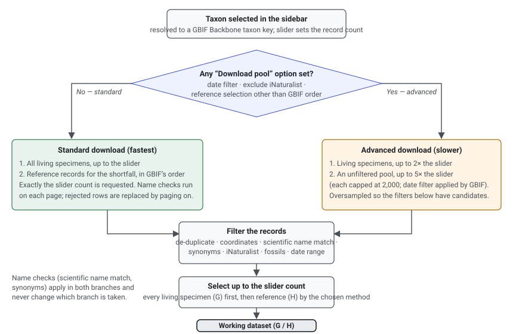

# GAMMa bug audit — 2026-10-17

Branch `dev` @ 8d03dd6. Environment: R 4.6.1, terra 1.9.50, sf 1.1.1, GEOS 3.12.1 / GDAL 3.8.4 / PROJ 9.4.0.

Method: eight subsystem-scoped review agents (GBIF pipeline, gap metrics, upload parser, data-analysis modules, maps, gap module + report, app shell/deploy, security/robustness) plus a test-suite run; every finding was then checked by two independent verifiers — one told to refute it by tracing callers and guards, one told to reproduce it (by running the function where pure). Only findings neither verifier could knock down are listed. Duplicates describing the same root cause were merged.

**Result:** 32 distinct bugs — 3 critical, 1 high, 14 medium, 14 low.

Severity scale: *critical* = wrong gap-analysis numbers or data loss; *high* = crash / unusable feature; *medium* = wrong UI or report state, degraded feature; *low* = cosmetic, edge case, or test quality.

## Test suite status

`Rscript tests/testthat.R`: **FAIL 3 | WARN 3 | SKIP 1 | PASS 311** (exit 1). `source("global.R")` succeeds.

All three failures are in `tests/testthat/test-gap_metrics.R` and are test-infrastructure problems rather than app logic (see findings L-11 and L-12 below):

- `tests/testthat/test-gap_metrics.R` — gap scores for Magnolia_acuminata_data.csv at 10 km match golden values (line 22): Failure: Expected `r$grs` to equal `case$grs` (9.826068). 1/1 mismatches: 9.83 - 9.83 == -1.2e-05 (exceeds tolerance = 1e-6).
- `tests/testthat/test-gap_metrics.R` — gap scores for Magnolia_acuminata_data.csv at 50 km match golden values (line 22): Failure: Expected `r$grs` to equal `case$grs` (14.550262). 1/1 mismatches: 14.6 - 14.6 == -6.82e-05 (exceeds tolerance = 1e-6).
- `tests/testthat/test-gap_metrics.R` — convex hull method estimates the range as a hull and clips G buffers to it (line 130): Error in `st_area.sfc(st_geometry(x), ...)`: package lwgeom required, please install it first. Raised by sf::st_area(hull$sf_model) at test-gap_metrics.R:130:3; lwgeom is not installed in this environment and is not a declared project dependency (only an sf Suggests entry in renv.lock/manifest.json).

Warnings: `NAs introduced by coercion` from `prep_lat_lon()` on non-numeric coordinates (`test-gap_metrics.R:68`); terra `[intersect] no intersection` leaks before the clear error for ocean-only input (`:152`, x2). Skipped: `test-ui_browser.R` (no Chrome/Chromium on this machine).

## Where the damage concentrates

- `R/gap_analysis_functions.R` — two bugs silently change GRS/ERS/FCS and the priority category.
- `R/module_data_analysis.R` — the delete/undo state can discard a freshly loaded dataset.
- `R/fctn_read_upload_file.R` — a non-UTF-8 CSV kills the session after a success toast.
- `reportTemplate.Rmd` — swapped buffer colours, NA types recoded to H, four unescaped sinks for uploaded text.

## Critical

### C-1. Convex hull computed in planar lon/lat wraps across the antimeridian; GRS collapses to 0

**Where:** `R/gap_analysis_functions.R:319`

**What happens:** convex_hull_range() hulls EPSG:4326 points with terra::convHull and clips with planar terra::intersect, so records straddling 180 deg longitude yield a hull spanning the Pacific; G buffers fall outside the clipped model and GRS/FCS are silently wrong.

**Failure scenario:** Four Fijian records (179.9,-16.8 G; -179.9,-17.5 H; 178.5,-16.5 H; 177.5,-18.1 H), hull method, 25 km: Area of model = 986,729 km2 (bbox xmin -149.9), G area 0, GRS 0.0, FCS 11.1, '[intersect] no intersection' warning; buffer method on the same points gives 2,002 km2, GRS 35.3, FCS 22.9. Control shape translated to Brazil gives a sane 26,409 km2 hull.

**Update steps:** In convex_hull_range() (R/gap_analysis_functions.R:313-326): if diff(range(terra::crds(v)[,1])) > 180, shift longitudes to 0..360 (lon[lon<0] + 360) before terra::convHull, clip against terra::rotate(land_proj, left = FALSE), then rotate the result back to -180..180; alternatively stop() with 'records cross the antimeridian; use the buffer method'. Add a Fiji fixture test.

### C-2. Rows with a non-G/H germplasm type are buffered and counted as conserved area and ERS universe despite being documented as ignored

**Where:** `R/gap_analysis_functions.R:355`

**What happens:** run_gap_analysis() builds v from every coordinate row (df_base <- data) and passes unfiltered v_clipped to GRSex (378), v to ERSex (383) and convex_hull_range (369); only gBuff/hBuff are type-filtered, so NA/'SEED'/'X' rows inflate GRS, the model area and the ERS universe, change FCS and the priority category, and draw an unlabelled grey buffer (module_gap_analysis.R:248), while module_controls.R:617 tells the user the rows are ignored.

**Failure scenario:** appData/Magnolia_acuminata_data_small.csv (5 G, 3 H), buffer method, 50 km: baseline GRS 61.92 / area 49,687 km2 / 4 ecoregions / Medium Priority. Blank one H row's type (or set 'X'): GRS 77.67, area still 49,687, 4 ecoregions, FCS 75.9, priority flips to Low. Truly dropping the row: GRS 73.49, area 41,866, 3 ecoregions. Three-point G/H/SEED case at 10 km: GRS 66.7 vs 50 and ERS 33.3 vs 50.

**Update steps:** In run_gap_analysis() (R/gap_analysis_functions.R) after `data <- prep_lat_lon(all_data)` (line 347) and before building df_base, add `data <- data[data[[target_col]] %in% c("G","H"), , drop = FALSE]; if (nrow(data) == 0) stop("No G or H records with valid coordinates to analyse.")`. This fixes GRS, ERS, hull input, sf_buffers and the grey buffer in one place. Add a test with a non-G/H row asserting GRS equals the G/H-only result.

### C-3. Undo Delete restores a stale backup after the dataset was replaced, discarding newly loaded data; empty Delete also overwrites the backup

**Where:** `R/module_data_analysis.R:230`

**What happens:** analysis_data_backup is written only by deleteSelection (211, before the empty-selection check) and cleared only by undoLastDelete (234); the controls module's four writers of analysis_data() never invalidate it, so Undo stays enabled and silently replaces a later GBIF gather or upload with the pre-delete snapshot (and resets gap results); a Delete with nothing selected overwrites the real backup so the last delete cannot be undone.

**Failure scenario:** Load 8 rows, delete 2 (backup = 8), gather 200 GBIF records (dataset = 200), click Undo Delete: dataset reverts to the old 8 rows, GBIF rows gone, toast 'Successfully restored -192 records', gap-analysis results cleared. Separately: 200 rows, delete 3, Clear Selection, Delete Selection again -> 'No records selected' but backup becomes the 197-row frame; Undo then restores 0 records and the original 200-row backup is lost.

**Update steps:** In R/module_data_analysis.R: (a) move `analysis_data_backup(analysis_data())` (line 211) below the `length(current_selection) == 0` early return; (b) record a fingerprint of the post-delete frame (e.g. `backup_sig(digest::digest(updated_data))` or nrow + index checksum) and in undoLastDelete `req(identical(sig(analysis_data()), backup_sig()))`, else disable the button; or add `observeEvent(analysis_data(), { if (!from_delete()) analysis_data_backup(data.frame()); from_delete(FALSE) }, ignoreInit = TRUE)` with a flag set in the delete handler. Also add `selected_points(numeric(0))` in the undo handler (see separate entry).

## High

### H-1. Non-UTF-8 (Windows-1252) CSV passes validation, then crashes the session when map labels are built

**Where:** `R/fctn_read_upload_file.R:36`

**What happens:** readr::read_csv is called without a locale/encoding, so a Latin-1 CSV loads with a success toast and invalid-UTF-8 strings; nchar() in truncate_label() (leaflet_maps.R:54) then errors inside observeEvent(analysis_data()) in module_map.R:50 and the Shiny session disconnects; a non-ASCII type column dies earlier in toupper() at utils.R:36 inside the upload observer.

**Failure scenario:** CSV row 'A1,Quercus alba,G,2001-01-01,33.5,-84.2,Caf\xe9 Ni\xf1o,Someone,' written in Windows-1252 (Excel 'CSV (Comma delimited)'): read_upload_file() returns 'Successfully loaded 1 records.'; merge_and_index() succeeds; the map observer throws 'invalid multibyte string, element 1' and the app greys out. Verified under shiny::testServer(mapModuleServer).

**Update steps:** In read_upload_file() (R/fctn_read_upload_file.R:36): detect encoding with `enc <- readr::guess_encoding(file_info$datapath)$encoding[1]` and pass `locale = readr::locale(encoding = if (is.na(enc)) "UTF-8" else enc)`; then for all character columns apply `iconv(x, from = "", to = "UTF-8", sub = "")` and reject/flag rows where `!validUTF8(x)`. Optionally wrap render_base_points() in module_map.R:54 in tryCatch with a notification.

## Medium

### M-1. manifest.json is stale: www/gbif_pipeline.svg missing from the Posit Connect file list

**Where:** `manifest.json:5572`

**What happens:** The About-page flowchart www/gbif_pipeline.svg (added 7a1994d, referenced by appData/about.md:82) is absent from manifest.json (last regenerated 8c2f268); on a git-backed Connect deploy markdown::mark() cannot inline it and leaves  which 404s. Checksums for about.md, utils.R, module_about.R, custom.css are stale too.

**Failure scenario:** Deploy dev to Posit Connect via manifest -> About -> 'How the GBIF download works' shows a broken-image placeholder; server log: "File 'www/gbif_pipeline.svg' not found (hence cannot be embedded)". Reproduced locally by rendering about.md from a tree lacking the SVG.

**Update steps:** Run `rsconnect::writeManifest()` at the repo root on dev and commit the regenerated manifest.json (adds www/gbif_pipeline.svg between www/gamma_banner.jpg and www/gather_photo.jpg and refreshes checksums). Optionally add a test that every local image referenced in appData/*.md exists and is listed in manifest.json.

### M-2. Excel date cells in Collection Date become serial numbers under col_types = 'text'

**Where:** `R/fctn_read_upload_file.R:45`

**What happens:** readxl::read_excel(col_types = "text") returns genuine date cells as the raw Excel serial string (e.g. '40769'), which flows unparsed into the DT table, popups, report and CSV export; fixtures store dates as text cells so no test catches it.

**Failure scenario:** Open www/upload_example.csv in Excel (Collection Date auto-converts to date cells), save as .xlsx, upload: status 'success' but every Collection Date shows '40769' instead of '2011-08-14' in the table, popups, report (reportTemplate.Rmd:238) and export. Verified with a hand-built xlsx (numFmtId 14 cells) under readxl 1.4.5.

**Update steps:** In read_upload_file() (R/fctn_read_upload_file.R:42-46): read with `col_types = "list"` (or guessed types), then for each column `if (inherits(x, c("Date","POSIXt"))) x <- format(x, "%Y-%m-%d")` before `as.character()`; alternatively detect all-numeric Collection Date and convert via `as.Date(as.numeric(x), origin = "1899-12-30")`. Add an xlsx fixture with real date cells.

### M-3. GBIF requests have no timeout; a stalled response blocks the R process for every session

**Where:** `R/gbif_functions.R:79`

**What happens:** rgbif::occ_search() is called without curlopts in gbif_counts() (79), gbif_fetch_standard() (153 via default occ) and gbif_fetch() (190); libcurl's default is no overall timeout, gbif_counts() fires automatically on taxon resolution, and Shiny is single-threaded so all users on the worker freeze.

**Failure scenario:** Local server that accepts the connection and sends headers plus 33 bytes of a 500,000-byte JSON body then stalls: rgbif:::gbif_GET with rgbif's default curlopts blocked past a 45 s kill; with curlopts = list(timeout_ms = 5000) it returned in 5.7 s with 'Timeout was reached', which the existing tryCatch wrappers convert to NA counts / 'GBIF download failed'.

**Update steps:** Define once in R/gbif_functions.R `GBIF_CURLOPTS <- list(timeout_ms = 30000, connecttimeout_ms = 10000, low_speed_limit = 1, low_speed_time = 30)` and pass `curlopts = GBIF_CURLOPTS` to rgbif::occ_search at lines 79 and 190 and into the default `occ` wrapper used by gbif_fetch_standard (line 143), e.g. `occ = function(...) rgbif::occ_search(..., curlopts = GBIF_CURLOPTS)`.

### M-4. 'Include taxonomic synonyms' has no effect while the default scientific-name check is on

**Where:** `R/gbif_functions.R:225`

**What happens:** gbif_apply_filters() applies gbif_name_matches() before the taxonomicStatus filter; synonym records carry the synonym's own genus/epithet so they are removed regardless of include_synonyms, making the checkbox a no-op under default settings although the tooltip (module_controls.R:180) and about.md describe it as independent.

**Failure scenario:** Fixture gbif_magnolia_fraseri.rds (1007 ACCEPTED, 2 SYNONYM 'Magnolia pyramidata' with acceptedScientificName 'Magnolia fraseri var. pyramidata'): gbif_apply_filters(pool, taxon_name = 'Magnolia fraseri', include_synonyms = FALSE) and TRUE both return 1007 rows; only with require_name_match = FALSE does TRUE return 1009. In the app, ticking the box and re-gathering loads the identical record set.

**Update steps:** In gbif_apply_filters() (R/gbif_functions.R:224-227), when include_synonyms is TRUE keep rows where either gbif_name_matches(df, taxon_name) or gbif_name_matches on acceptedScientificName (strip authorship, compare canonical prefix); e.g. `keep <- gbif_name_matches(df, taxon_name) | (isTRUE(include_synonyms) & gbif_accepted_name_matches(df, taxon_name))`. Also state the dependency in the tooltip at module_controls.R:180. Add a test with taxon_name set and include_synonyms TRUE expecting the synonym rows.

### M-5. Date filter silently overrides the chosen reference-selection method (random / spatial / recent)

**Where:** `R/gbif_functions.R:307`

**What happens:** gbif_select_records() tests `if (isTRUE(yearly_spread))` first and the method branches sit in its else; gbif_gather() always passes yearly_spread = !is.null(date_range), so any date filter makes random/spatial/recent return pool order, contrary to the tooltips (module_controls.R:139-154) and about.md:84.

**Failure scenario:** Fixture pool, limit 60, date_range 1900-01-01..2030-12-31: gbif_gather(method='random'), 'spatial', 'recent' and 'gbif' return identical Accession Number vectors; select_spatially_spread() is called 0 times; mean nearest-neighbour distance of selected H records is 0.14 deg (clustered) vs 0.85-1.3 deg without the date filter. 'Random' run twice returns identical records although the tooltip says 'Differs on every run'.

**Update steps:** In gbif_select_records() (R/gbif_functions.R:307-322) restructure: first order/sample `other` according to `method` (slice_sample / select_spatially_spread / arrange desc date / identity), then if yearly_spread is TRUE take one record per year from that ordered set before filling the remainder from the same ordering. Add a test asserting method='spatial' + date_range differs from method='gbif' + date_range and calls select_spatially_spread.

### M-6. render_base_points() always re-fits the map, so deleting records re-zooms despite the documented keep-the-view behaviour

**Where:** `R/leaflet_maps.R:249`

**What happens:** render_base_points() ends with an unconditional leafletProxy() |> fitBounds() over all points (no padding/maxZoom), so the previous_n guard in module_map.R:57 is dead code: every delete and undo snaps the view to full extent (double-fit on growth), and a single remaining point zooms to level 16.

**Failure scenario:** Load 200 records, zoom into a cluster, select one outlier, Delete Selection: the map jumps back to the full extent of the remaining 199 records. Verified under shiny::testServer: 200->199 emits fitBounds(maxZoom=NONE); down to 1 row emits zero-size bounds with no maxZoom.

**Update steps:** Delete the 'Fit Bounds' block at R/leaflet_maps.R:248-257 from render_base_points(); module_map.R:56-59 already calls fit_map_to_points() (padding, maxZoom 10) only when the row count grew. Verify no other caller relied on the implicit fit (module_map.R:54 is the only caller).

### M-7. Gather button stays enabled with a stale taxon when selected_taxon()'s req() fails

**Where:** `R/module_controls.R:383`

**What happens:** The toggleState observer calls selected_taxon_id() -> selected_taxon(), which starts with req(genus, species, rank); when species/rank are cleared by updateSelectizeInput the req raises shiny.silent.error, the observer is cancelled before toggleState(FALSE), and the button keeps its enabled state while Target Taxon ID goes blank; clicks hit req(tid) at 487 and do nothing.

**Failure scenario:** Resolve Magnolia fraseri (button enabled), then change species to acuminata: server sees Magnolia/acuminata/species -> toggleState(TRUE), then rank resets to '' -> req fails -> observer aborted; button enabled, Taxon ID blank, Gather click silently ignored. Same for genus switches where the epithet exists in both genera (Magnolia virginiana -> Quercus). Reproduced under testServer with toggleState logged.

**Update steps:** In R/module_controls.R:380-385 use `condition = isTruthy(tryCatch(selected_taxon_id(), error = function(e) NULL))`, or change selected_taxon() (line 390) to `if (!isTruthy(input$taxon_genus) || !isTruthy(input$taxon_species) || !isTruthy(input$taxon_rank)) return(NULL)` so an incomplete selection yields NULL rather than a silent error; also add a showNotification in the loadGBIF handler when tid is NULL.

### M-8. last_gather() is set before the GBIF overwrite is confirmed, so Cancel leaves the sidebar claiming unloaded records were loaded

**Where:** `R/module_controls.R:550`

**What happens:** In the loadGBIF observer last_gather(result) runs before the has_gbif branch; when the 'Overwrite GBIF Data?' modal is cancelled (client-side modalButton, no server observer) analysis_data() is unchanged but gbif_summary_display renders 'Loaded: n G / m H' from the unloaded result, and gbifData_temp stays populated.

**Failure scenario:** Gather Magnolia fraseri at limit 100 (91 H loaded). Set slider to 50, Gather, Cancel: dataset still 100 rows / 91 H, sidebar reads 'Loaded: 9 G / 41 H (standard download, 50 records requested)'. Verified under testServer with the rendered output text.

**Update steps:** In R/module_controls.R move `last_gather(result)` from line 550 into the else branch (line 570, where analysis_data is updated) and into the confirmLoadGBIF handler (store `pending_gather(result)` alongside gbifData_temp at 557 and promote it on confirm); replace modalButton('Cancel') with an actionButton(session$ns('cancelLoadGBIF')) plus an observer that clears gbifData_temp/pending_gather and removeModal().

### M-9. Undo Delete does not clear selected_points, so a selection made after the delete targets different records once indices shift back

**Where:** `R/module_data_analysis.R:232`

**What happens:** deleteSelection re-indexes rows and clears the selection, but undoLastDelete restores the pre-delete frame (old index values) without resetting selected_points(); any index selected between delete and undo now refers to a different row, moving map halos and DT selection and making the next Delete remove the wrong record.

**Failure scenario:** 10 rows; delete index 2 (rows 3..10 become 2..9); click the marker now at index 2 (original row 3); Undo: index 2 is original row 2 again, so the highlight and table selection jump to a record the user never selected, and Delete Selection would remove it.

**Update steps:** In the undoLastDelete observer (R/module_data_analysis.R:229-235) add `selected_points(numeric(0))` immediately after `analysis_data(analysis_data_backup())`, mirroring line 221 and module_controls.R:592/700.

### M-10. Gap map keeps stale record markers when the dataset becomes empty or loses all coordinates; Run button silently no-ops

**Where:** `R/module_gap_analysis.R:147`

**What happens:** The marker observer does req(nrow(all_data) > 0) (147) and req(nrow(data) > 0) (151) before clearGroup('Reference Records'/'Germplasm Records') (157-159), so a transition to zero rows (or all-NA coordinates) leaves the previous dataset's markers on the gap map; the invalidation observer clears only analysis layers, and Run Gap Analysis exits at req() (210) with no notification.

**Failure scenario:** Load records, open Gap Analysis (points drawn), select every point with the rectangle tool, Delete Selection: data map clears and the instructions panel returns, but the gap map still shows all deleted records as markers; clicking Run Gap Analysis does nothing. Verified under testServer with leaflet:::invokeRemote intercepted: no clearGroup for the two marker groups is emitted.

**Update steps:** In R/module_gap_analysis.R:145-160 build the proxy and issue the two leaflet::clearGroup() calls before the req() checks (or replace req() with `if (nrow(all_data) == 0 || nrow(data) == 0) { proxy %>% clearGroup(...); return() }`); in the generate_buffers handler (208-212) replace `req(nrow(all_data) > 0)` with a showNotification('No records to analyse') + return().

### M-11. ERS Regions palette infers levels from data, so a single-status result is filled with a blended colour matching neither status

**Where:** `R/module_gap_analysis.R:267`

**What happens:** pal_ers uses colorFactor(..., domain = res$sf_ers_regions$gap_status) with no fixed levels; when every ecoregion is 'Gap Ecoregion' (any H-only/GBIF-only dataset) or 'Covered', leaflet rescales one level to 0.5 and interpolates, painting all polygons #80B5A6 instead of #728587 / #8ae6c7; the report (reportTemplate.Rmd:224) uses fixed levels so app and report disagree.

**Failure scenario:** H-only subset of Magnolia_acuminata_data_small.csv, buffer, 50 km: all 6 ecoregions are 'Gap Ecoregion'; the module's palette returns #80B5A6 for each. With leaflet 2.2.3, colorFactor(ersexColors, domain = rep('Gap Ecoregion', 2))('Gap Ecoregion') == '#80B5A6'; with levels fixed it returns '#728587'.

**Update steps:** At R/module_gap_analysis.R:267 replace `domain = res$sf_ers_regions$gap_status` with `levels = c("Covered", "Gap Ecoregion")`, i.e. `leaflet::colorFactor(c(ersexColors[1], ersexColors[2]), levels = c("Covered", "Gap Ecoregion"))`, matching pal_type at 242-245.

### M-12. HTML report renders uploaded free text as raw HTML in four sinks (records table, subtitle, popup Type/Source, scores table via litedown)

**Where:** `reportTemplate.Rmd:325`

**What happens:** User-supplied strings reach the shared report unescaped: DT::datatable(rec, escape = FALSE) for every column (Rmd:325); the YAML subtitle `{r} params$taxon` rendered as raw Markdown/HTML (Rmd:3); gen_popup() concatenating Type/Source raw (Rmd:236); and report_table()'s htmlEscape() output being decoded by litedown's restore_html() because a knitr_kable of format html is emitted as a {=html} raw block (R/report_render.R:39). Legitimate names with '<' or '&' are mangled; a crafted upload executes script when the report is opened.

**Failure scenario:** Upload Magnolia_acuminata_data_small.csv with Taxon Name '' and a Locality '', run analysis, download report: subtitle contains the raw img tag, the Conservation scores table cell is '<td>  </td>', and the records-table DT JSON holds 8 raw copies plus the script payload; opening the HTML fires the handlers. Locality 'Forest <near river> & lake' displays as 'Forest & lake'.

**Update steps:** (1) reportTemplate.Rmd:325: `DT::datatable(rec, escape = which(names(rec) != "Accession Number"), ...)` so only the pre-built GBIF link column is raw. (2) reportTemplate.Rmd:3: set `subtitle: "`{r} htmltools::htmlEscape(params$taxon)`"` (or escape in render_gap_report before passing params). (3) reportTemplate.Rmd:236: wrap data[[col_name]] and data$source in htmltools::htmlEscape(). (4) R/report_render.R:39: instead of returning the knitr_kable object, `cat(as.character(knitr::kable(...)))` inside a results='asis' chunk (raw HTML blocks are passed through untouched) or return htmltools::HTML(). Add a test rendering a report with '<b>' in Taxon Name and asserting '&lt;b&gt;' appears and '<b>' does not.

### M-13. Report recodes blank germplasm types to 'H', so its G/H counts and map contradict the SRS it prints and the app's 'ignored' warning

**Where:** `reportTemplate.Rmd:60`

**What happens:** The setup chunk runs tidyr::replace_na(points[[col_name]], 'H') (60) and the same for records (64); the facts box (100), occurrence table (109-126), ecoregion counts (290) and the report map's H layer then include NA-typed rows as reference records, while SRSex()/generateCounts() excluded them and the app map (module_gap_analysis.R:154) omits them.

**Failure scenario:** Upload 1 G, 1 H, 2 blank-type rows (all with coordinates): run_gap_analysis gives SRS 100 (Total H records = 1); the report shows 'Germplasm / reference: 1 G, 3 H', 'H records = 3' in the occurrence table next to 'SRS ex situ 100.0', and draws 3 H markers where the app draws 1. Fixture with 5 G, 2 H, 1 blank: app warns '1 record ... ignored', report says '5 G, 3 H'.

**Update steps:** In reportTemplate.Rmd remove the two replace_na calls (lines 60 and 64) and instead filter to the rows the metrics used: `points <- points[points[[col_name]] %in% c("G","H"), ]; records <- records[records[[col_name]] %in% c("G","H"), ]` (or keep the rows but compute counts with `== "G"`/`== "H"` and na.rm so they match generateCounts()). Once the gap_analysis_functions.R:355 fix lands, res$points will already be G/H-only; records still needs the filter.

### M-14. Report map colours G buffers with the H colour and vice versa (swapped versus legend and app)

**Where:** `reportTemplate.Rmd:202`

**What happens:** pal_type <- colorFactor(c('H' = combinedColor[1], 'G' = combinedColor[2]), domain = c('H','G')) relies on vector names, but leaflet::colorFactor ignores names and maps colours positionally onto the sorted levels c('G','H'); G buffers render orange (the reference colour) and H purple, contradicting the report legend (270-271), the point markers (247/254), the popups and the app map (module_gap_analysis.R:242-245). In hull mode all drawn G buffers appear in the H colour. pal_ers at 224 is correct only because 'Covered' sorts before 'Gap Ecoregion'.

**Failure scenario:** Any buffer-method analysis with both G and H records: in the downloaded report germplasm buffers are #F1A340 (orange) and reference buffers #542788 (purple) while the legend says orange = H, purple = G, and an orange polygon's popup reads 'Germplasm buffer'. Verified: colorFactor(c('H'='#f1a340','G'='#542788'), domain=c('H','G'))(c('H','G')) returns '#542788' '#F1A340'.

**Update steps:** At reportTemplate.Rmd:202 use `colorFactor(palette = c(combinedColor[1], combinedColor[2]), levels = c("H", "G"))` exactly as module_gap_analysis.R:242-245 does; at line 224 likewise use `levels = c("Covered", "Gap Ecoregion")` with an unnamed palette so it does not depend on sort order.

## Low

### L-1. CI only runs on pushes to main, not on dev as README and the workflow header state

**Where:** `.github/workflows/tests.yml:8`

**What happens:** The push trigger is `branches: [main]` while the header comment and README.md:45 say the suite runs on every push/PR; all recent development is direct commits on dev (5 commits ahead of main, no PRs), so none of them ran CI.

**Failure scenario:** Push a commit that breaks merge_and_index() to dev: no workflow run, no red check; the regression surfaces only when a PR to main is opened or someone runs tests locally.

**Update steps:** Change .github/workflows/tests.yml line 8 to `branches: [main, dev]` (or remove the branches filter), or correct the header comment and README to say 'on pushes to main and on pull requests'.

### L-2. Two headers normalising to the same canonical name produce a sticky 'Critical error' instead of a validation message

**Where:** `R/fctn_read_upload_file.R:15`

**What happens:** normalise_upload_headers() renames every case/whitespace variant of a known column to the canonical spelling without checking for collisions; 'Latitude' plus 'latitude' yields duplicate names, dplyr::mutate at line 68 fails, and the generic tryCatch reports 'Critical error reading file: Can't transform a data frame with duplicate names.' as a system_error with a never-dismissing notification.

**Failure scenario:** Upload a CSV with the standard nine headers plus an extra 'latitude' column: read_upload_file() returns status 'system_error' with that message; module_controls.R:650 shows a red sticky notification and resets the file input, with no hint which column is duplicated.

**Update steps:** In normalise_upload_headers() (R/fctn_read_upload_file.R:10-18) after computing nms, `dups <- unique(nms[duplicated(nms)]); if (length(dups)) return a validation_error` (e.g. via a stop() with a custom class caught at line 108, or a status field) with message 'Duplicate columns after normalising header names: <dups>'.

### L-3. Semicolon/tab-delimited CSV (or xlsx renamed .csv) is rejected with a false 'Missing columns' list naming every required column

**Where:** `R/fctn_read_upload_file.R:36`

**What happens:** Only readr::read_csv (comma) is used with no delimiter sniffing and no check that more than one column was parsed; a semicolon-delimited file (Excel default in many locales) parses to a single column whose name is the whole header line, so the user is told all six required columns are missing although they are present.

**Failure scenario:** Upload 'Accession Number;Taxon Name;Current Germplasm Type;Collection Date;Latitude;Longitude;Locality;Collector;issues' + one row as data.csv: validation_error 'Data not loaded.  Missing columns: Accession Number, Taxon Name, Current Germplasm Type, Collection Date, Locality, Collector'. Same for tab-delimited, empty, and xlsx-renamed-.csv files.

**Update steps:** In read_upload_file() (R/fctn_read_upload_file.R:36) use `readr::read_delim(datapath, delim = NULL, col_types = cols(.default = 'c'))` (auto-detects , ; tab) and after reading add `if (ncol(data) <= 1) return(validation_error('The file parsed as a single column; check that it is comma- or semicolon-delimited and not an Excel file renamed .csv'))`.

### L-4. Map hover labels insert Current Germplasm Type as raw HTML

**Where:** `R/leaflet_maps.R:66`

**What happens:** point_labels() escapes Taxon Name, Collector and Locality but concatenates data$`Current Germplasm Type` directly; merge_and_index() only trims/upper-cases it, so markup in an uploaded type value is live in the Data Analysis map tooltip (self-XSS; the gap map filters to G/H first so is not reachable).

**Failure scenario:** Upload a CSV whose Current Germplasm Type is '' with valid coordinates: the data-map label HTML contains '' unescaped (entity-encoded handlers survive upper-casing).

**Update steps:** At R/leaflet_maps.R:66 replace `data$\`Current Germplasm Type\`` with `htmltools::htmlEscape(as.character(data$\`Current Germplasm Type\`))`; extend test-leaflet_helpers.R:10 to include a '<' in the Type column.

### L-5. Standard-download summary labels the retained pool size as 'records requested'

**Where:** `R/module_controls.R:467`

**What happens:** For mode == 'standard' the sidebar prints loaded$steps$raw as '%s records requested', but in standard mode the pool has already been filtered per page by keep() and may be short when GBIF runs out, so steps$raw is the number retained, not the slider value.

**Failure scenario:** Slider 1057 on the fixture pool (1007 matching): sidebar reads 'Loaded: 9 G / 998 H (standard download, 1,007 records requested)' although 1,057 were requested. Any rare taxon with fewer records than the slider shows the same mislabel.

**Update steps:** Either change the sprintf at R/module_controls.R:467 to '%s records retrieved', or add `limit = limit` to the list returned by gbif_gather() (R/gbif_functions.R ~395) and print `loaded$limit` as 'requested' alongside the retrieved count.

### L-6. Max Occurrences slider at 0 reports 'No records with coordinates found on GBIF'

**Where:** `R/module_controls.R:540`

**What happens:** The slider allows 0 (min = 0, step = 50) and selection_limit is not validated; standard mode makes no request and returns an empty pool, so the observer shows 'No records with coordinates found on GBIF for this taxon.'; advanced mode fetches the pool but selects 0 rows and shows 'All retrieved records were removed by the current filters'. Neither mentions the real cause.

**Failure scenario:** Select Magnolia fraseri, drag slider to 0, Gather: warning 'No records with coordinates found on GBIF for this taxon.' while the summary above shows thousands of records. Tick 'Exclude iNaturalist' and Gather: 'All retrieved records were removed by the current filters ...'.

**Update steps:** Set `min = 50` on the sliderInput at R/module_controls.R:60, or at line 489 add `if (!is.numeric(input$gbif_limit) || input$gbif_limit <= 0) { showNotification('Set Max Occurrences above 0', type = 'warning'); return() }`.

### L-7. Record-count control is not removed when the dataset becomes empty, leaving stale GBIF/Upload counts on the data map

**Where:** `R/module_map.R:63`

**What happens:** map_count_control() returns NULL for an empty dataset and the observer only touches the control inside `if (!is.null(count_html))`, so removeControl('gbif_upload_counts') never runs on the empty transition; markers are cleared but the bottom-left counter keeps the deleted dataset's numbers.

**Failure scenario:** Load 8 upload records, rectangle-select all, Delete Selection: markers gone, instructions panel shown, counter still reads 'GBIF: 0 G, 0 H | Upload: 5 G, 3 H'. Verified under testServer: only render_base_points(n=0) is called, no removeControl.

**Update steps:** In R/module_map.R:62-71 call `leafletProxy('dataEvalMap') %>% leaflet::removeControl('gbif_upload_counts')` unconditionally, then `if (!is.null(count_html)) ... addControl(...)`.

### L-8. Bootstrap Icons classes used in banner, feedback link and footer but no Bootstrap Icons stylesheet is loaded

**Where:** `R/utils.R:65`

**What happens:** app_banner_ui() (65, 74) and footer_ui() (171-183) emit <i class='bi bi-...'>; bslib::bs_theme(version = 5) ships no Bootstrap Icons font, bsicons is not installed, and nothing links the stylesheet, so the info, chat, envelope, github and bug glyphs render as empty elements. Everywhere else the app uses shiny::icon() (Font Awesome, which is loaded).

**Failure scenario:** Open any page: the beta banner shows only text with no info-circle glyph, ' · Give feedback' has a blank gap where the chat icon should be, and footer Contact items have no leading icons. Verified via htmltools::findDependencies(ui): 25-27 dependencies, none bootstrap-icons; rendered body has 12-14 empty bi elements.

**Update steps:** Replace the six tags$i(class = 'bi bi-*') calls in R/utils.R (lines 65, 74, 171, 175, 179, 183) with shiny::icon('circle-info'), icon('comment'), icon('envelope'), icon('github'), icon('bug'), icon('comment'); or add bsicons to renv.lock and use bsicons::bs_icon().

### L-9. Report describes the ERS universe as 'ecoregions occupied by the estimated range' but the code uses ecoregions containing records

**Where:** `reportTemplate.Rmd:278`

**What happens:** Lines 278 and 342 describe a range-based denominator, whereas ERSex() (R/gap_analysis_functions.R:254) uses terra::intersect(gapPoints, ecoRegions), i.e. ecoregions with at least one record, under both methods; appData/find_gaps.md:16 documents the code's behaviour correctly.

**Failure scenario:** Magnolia_acuminata_data.csv, buffer 50 km: ERS table holds 12 ecoregions while the buffer polygon on the report map crosses 24; hull method: 12 vs 88. Ecoregions visibly crossed by the range are missing from a table captioned as listing all of them.

**Update steps:** Reword reportTemplate.Rmd:278 to 'All terrestrial ecoregions containing at least one analysed record' and line 342 to 'out of the number of ecoregions containing records' (or, if a range-based denominator is intended, change ERSex() deliberately with new golden values).

### L-10. Priority-category boundaries in the report's Definitions contradict fcs_priority()

**Where:** `reportTemplate.Rmd:346`

**What happens:** The Definitions text says UP when FCS < 25, HP when 25 <= FCS < 50, MP when 50 <= FCS < 75, LP when FCS >= 75, but fcs_priority() (R/gap_analysis_functions.R:38-44) uses <= 25, <= 50, <= 75 and test-gap_metrics.R:57-59 pins that, so at FCS exactly 25/50/75 the printed category contradicts the paragraph on the same page.

**Failure scenario:** SRS 100, GRS 25, ERS 25 -> FCS 50.0: score cards and table say 'High Priority (HP)' while the Definitions paragraph says 50 <= FCS < 75 is Medium Priority. SRS 75, GRS 0, ERS 0 -> FCS 25.0 -> 'Urgent' vs text 'High'.

**Update steps:** Rewrite reportTemplate.Rmd:346 to 'UP when FCS ≤ 25, HP when 25 < FCS ≤ 50, MP when 50 < FCS ≤ 75, LP when FCS > 75' (matches code and tests); or, if the published strict-< convention is intended, change fcs_priority() and the pinned test together and regenerate find_gaps.md.

### L-11. Golden GRS values for Magnolia_acuminata_data.csv fail at tolerance 1e-6 due to system geometry-library drift

**Where:** `tests/testthat/test-gap_metrics.R:22`

**What happens:** The two full-dataset GRS goldens differ by 1.2e-5 (10 km) and 6.8e-5 (50 km) from the computed values, exceeding the 1e-6 relative tolerance; a verifier rebuilt terra 1.9-34 and got byte-identical numbers, so the drift comes from GEOS/GDAL/PROJ (unpinned by renv.lock) rather than the terra bump. CI on ubuntu-latest likely shows the same red. gap_cases$n_buffers values are stale and never asserted.

**Failure scenario:** Rscript tests/testthat.R: 'gap scores for Magnolia_acuminata_data.csv at 10 km match golden values' and '... at 50 km ...' fail at line 22 (9.83 - 9.83 == -1.2e-05; 14.6 - 14.6 == -6.82e-05). The file header says any mismatch 'must be deliberate', so a developer cannot distinguish this from a real GRS regression.

**Update steps:** At tests/testthat/test-gap_metrics.R:22 use `expect_equal(r$grs, case$grs, tolerance = 1e-4)` (geodesic area after GEOS union is reproducible only to ~1e-5 across stacks); either assert `nrow(r$sf_buffers)` against corrected n_buffers (2) or delete the n_buffers field from gap_cases; note the GEOS/GDAL/PROJ versions in the header comment.

### L-12. Hull test calls sf::st_area on lon/lat geometry with s2 off, requiring lwgeom which is not in renv.lock

**Where:** `tests/testthat/test-gap_metrics.R:130`

**What happens:** global.R:32 sets sf::sf_use_s2(FALSE); with s2 off sf::st_area() on geographic coordinates dispatches to lwgeom, which is only an sf Suggests entry, not a project dependency, so 'convex hull method estimates the range as a hull and clips G buffers to it' errors before any assertion in any environment restored from renv.lock (local, CI, Docker). The app itself never calls sf::st_area.

**Failure scenario:** renv::restore() then Rscript tests/testthat.R: test-gap_metrics.R:130 'Error in st_area.sfc(): package lwgeom required, please install it first'; the remaining hull assertions (area equality, G-only buffers, GRS range) never run.

**Update steps:** Replace line 130 of tests/testthat/test-gap_metrics.R with `hull_area_km2 <- sum(terra::expanse(terra::vect(hull$sf_model), unit = "km"))` (verified equal to hull$grs$`Area of model km2` = 2,109,402) and compare that; or `sf::st_area(sf::st_transform(hull$sf_model, 5070))`; or add lwgeom to renv.lock and `skip_if_not_installed('lwgeom')`.

### L-13. Date-filter test is vacuous: no fixture record falls in 2015-2018

**Where:** `tests/testthat/test-gbif_functions.R:78`

**What happens:** The test filters the fixture to 2015-01-01..2018-12-31, but fixture years are 2010, 2011, 2023-2026 (plus 2 NA), so dated$data has 0 rows; all() over an empty vector is TRUE and the step-count equality is 0 == 0, so a filter that drops every record passes.

**Failure scenario:** Replace R/gbif_functions.R:250 with `df <- df[FALSE, , drop = FALSE]`: lines 80-81 still pass. (An inverted comparison is caught, and the #72 test covers one planted record only.)

**Update steps:** At tests/testthat/test-gbif_functions.R:78 use `date_range = as.Date(c('2023-01-01', '2024-12-31'))` (610 rows on the fixture) and add `expect_gt(nrow(dated$data), 0)` and `expect_lt(nrow(dated$data), nrow(pool))` before the existing assertions.

### L-14. Fixture '..._excel_missing_lat.xlsx' actually lacks Longitude; the missing-Latitude branch is never exercised

**Where:** `tests/testthat/test-read_upload_file.R:48`

**What happens:** appData/upload_sample_manual_properly_formatted_excel_missing_lat.xlsx contains Latitude and lacks Longitude; the test asserts only message_type == 'warning' and '200 records have invalid coordinates', which is true for either missing column, so the Latitude-injection branch at R/fctn_read_upload_file.R:71 has no fixture coverage and the fixture/test names mislead.

**Failure scenario:** Mutate line 71 to inject Longitude into Latitude: the test at lines 48-51 still passes; fed a CSV truly lacking Latitude, the mutant silently produces Latitude = -84.2 copied from Longitude.

**Update steps:** Add an in-memory or fixture input with no Latitude column (e.g. drop it from appData/upload_sample_small.csv in the test), call read_upload_file(), and assert `all(is.na(res$data$Latitude))` and `!all(is.na(res$data$Longitude))`; rename the existing fixture to ..._missing_lon.xlsx and assert `all(is.na(Longitude))` for it.

## Suggested order of work

1. **C-2, C-1, M-10, M-11** (`gap_analysis_functions.R`, `module_gap_analysis.R`) — the G/H filter is a two-line change that also removes the grey buffer and half of the report count mismatch (M-13); regenerate golden values afterwards.
2. **C-3, M-9** (`module_data_analysis.R`) — undo invalidation and clearing `selected_points`; both touch the same observer block.
3. **H-1, M-2, L-2, L-3** (`fctn_read_upload_file.R`) — encoding, Excel dates, duplicate headers, delimiter sniffing; one pass over the reader with new fixtures.
4. **M-12, M-13, M-14, L-9, L-10** (`reportTemplate.Rmd`, `report_render.R`) — escaping, `replace_na`, swapped palette, wording.
5. **M-3, M-4, M-5** (`gbif_functions.R`) — timeouts first (one constant), then synonym and selection-method logic with new tests.
6. **M-6, M-7, M-8, L-4, L-5, L-6, L-7, L-8** — UI state fixes in controls/map modules, hover-label escaping, and the icon stylesheet.
7. **M-1, L-1, L-11..L-14** — regenerate `manifest.json`, widen CI to `dev`, repair the four tests.

## Checked and found clean

- Test files passing in full: `test-gbif_functions.R` (118), `test-module_controls.R` (35), `test-read_upload_file.R` (37), `test-merge_and_index.R` (17), `test-module_gap_analysis.R` (14), `test-leaflet_helpers.R` (12). `global.R` sources without error.
- Buffer-method GRS/SRS/ERS arithmetic on G/H-only data: small-fixture and upload_sample goldens reproduce exactly; the 200-row set within 5e-6 relative. `terra::buffer()` splits correctly at ±180° (the antimeridian bug is hull-only).
- `fcs_priority()`/`compute_fcs()` consistent with their tests; the app and report print the same category.
- Upload path: header normalisation, required-column check, coordinate-NA injection and the xlsx branch behave as documented (the xlsx branch is immune to the encoding crash). Exact duplicate headers are repaired by readr.
- `reactiveVal` identical-value short-circuit means a no-op Undo does not re-trigger the gap module's "Dataset Modified" modal (a sub-claim in two raw findings was wrong and is omitted above).
- `leaflet::colorFactor` with out-of-level values returns na.color #808080 rather than crashing; DT and the CSV export tolerate invalid UTF-8 (U+FFFD), so only the map observer is fatal.
- Deploy: `uploadtoshinyio.R` and the Dockerfile bundle `www/` directly, so the stale manifest affects only Posit Connect. `.rscignore` does not exclude `www/`.
- GBIF `tryCatch` wrappers correctly convert errors (once a timeout is configured) into NA counts / a failure notification.
- `report_table()` escapes correctly in isolation; `gen_popup()` escapes Taxon/Collector/Locality/Accession/Date; `point_labels()` escapes all fields but Type.
